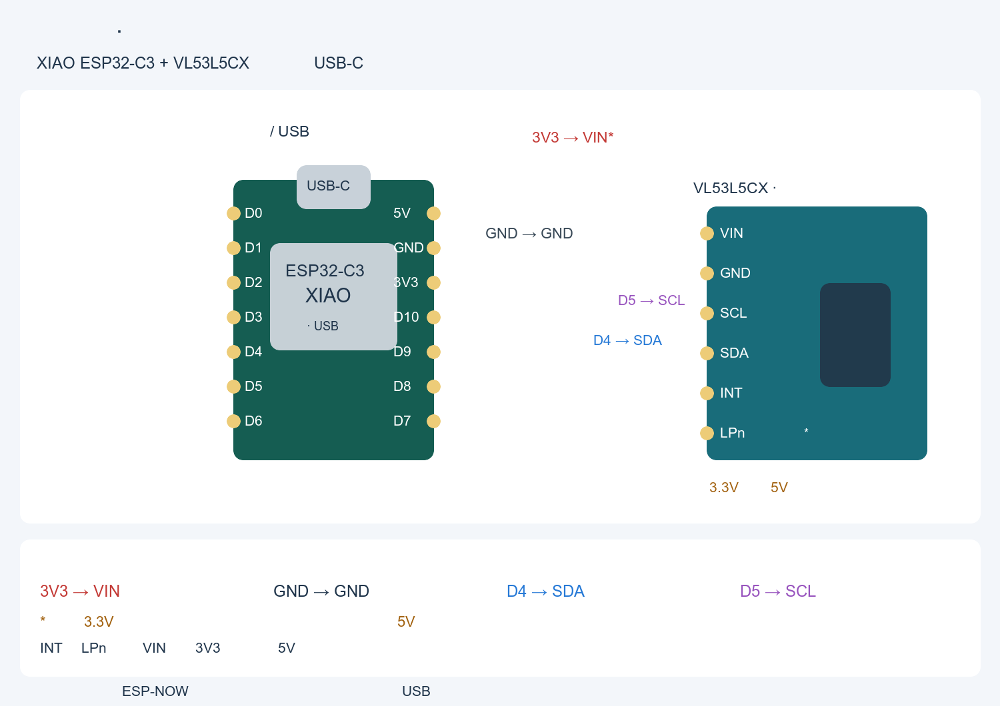
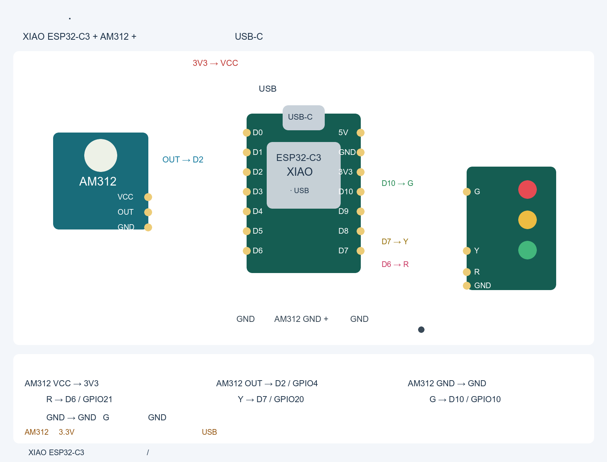

# 门后有人提示器

两块 [Seeed Studio XIAO ESP32-C3](https://www.seeedstudio.com/Seeed-XIAO-ESP32C3-p-5431.html) 组成一套开门提醒。门后板用 VL53L5CX 做 8×8 测距，判断门后是否有前景物体；门前板用红、黄、绿三色灯把结果亮出来。两块板通过加密 ESP-NOW 直连，不连接路由器，也不需要在两块板之间拉线。

灯的含义：

- **红灯**：门后检测到前景物体。
- **绿灯**：当前检测规则没有检测到前景。
- **黄灯闪烁**：未知。无线中断、传感器未就绪、数据超过 1 秒、有效区域不足或正在校准时都是黄灯。未知状态不会亮成绿灯。

绿灯只表示这套几何规则没有检出目标，不表示门外一定没有人。开门时仍要自己看。

当前配套固件在 [`firmware/door-guard`](firmware/door-guard)。检测规则、桌面模式和装到门框后的空场校准写在 [固件说明](firmware/door-guard/README.md)。

## 硬件

| 数量 | 零件 | 购买 |
| --- | --- | --- |
| 2 | Seeed Studio XIAO ESP32-C3 | [Seeed 官方](https://www.seeedstudio.com/Seeed-XIAO-ESP32C3-p-5431.html) |
| 1 | VL53L5CX 8×8 测距模块 | [Pololu #3417](https://www.pololu.com/product/3417) |
| 1 | AM312 微型人体红外模块，需能在 3.3V 工作 | [TinyTronics AM312](https://www.tinytronics.nl/en/sensors/motion/ir-pyroelectric-infrared-pir-motion-sensor-detector-module-mini) |
| 1 | 共阴红黄绿信号灯，高电平点亮，模块自带限流电阻 | [Cytron 交通灯模块](https://www.cytron.io/p-traffic-light-led-module) |

调试时两块板都用 USB-C 供电。排针要焊牢，不能只把杜邦线插在孔里。改接线前先拔掉 USB。

下面两张接线图按这块六针测距模块绘制，引脚从上到下是 VIN、GND、SCL、SDA、INT、LPn。Pololu #3417 是同一颗传感器的载板，引脚排列不同，买到后按载板丝印接线，不要照着这张图的孔位插。信号灯和红外模块也以板上的字母为准，不按灯珠排列或导线颜色判断。

## 门后接线

开发板正面朝向自己，USB 朝上。测距模块 VIN 接 3V3，不要接 5V。INT 和 LPn 留空。

| 测距模块 | XIAO ESP32-C3 |
| --- | --- |
| VIN | 3V3 |
| GND | GND |
| SCL | D5 / GPIO7 |
| SDA | D4 / GPIO6 |
| INT | 不接 |
| LPn | 不接 |

## 门前接线

开发板正面朝向自己，USB 朝上。AM312 的 VCC 接 3V3。信号灯是共阴：R、Y、G 是三色输入，GND 才是地。模块上如果把绿灯和地都标成 G，先对一下丝印，地线接到 GND。

| 外设 | XIAO ESP32-C3 |
| --- | --- |
| AM312 VCC | 3V3 |
| AM312 OUT | D2 / GPIO4 |
| AM312 GND | GND |
| 信号灯 R | D6 / GPIO21 |
| 信号灯 Y | D7 / GPIO20 |
| 信号灯 G | D10 / GPIO10 |
| 信号灯 GND | GND |

## 烧录

在 `firmware/door-guard` 里用 PlatformIO 分别构建 `rear` 和 `front`。两块板的角色由 MAC 地址绑定，烧到错误的板子上不会启用无线配对。重插 USB 后串口名称会变，烧录前先读芯片 MAC。

配对密钥在 `firmware/door-guard/include/pairing_keys.h`，没有放进仓库。两块板必须使用同一份密钥，更换后要一起重烧。
